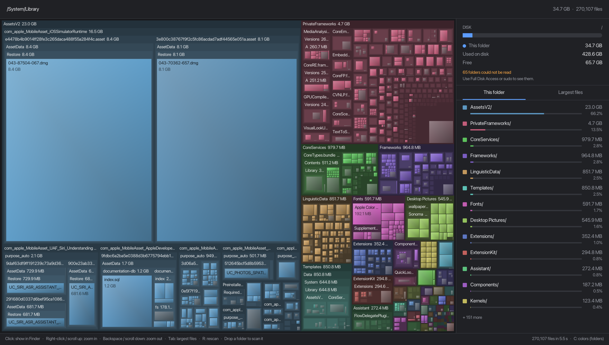

<h1 align="center">diskfull</h1>

<p align="center">
  <b>See what is really filling your disk.</b><br>
  A fast treemap disk analyzer for macOS, Linux and Windows.
</p>

<p align="center">
  <a href="https://github.com/hubastard/diskfull/releases/latest"></a>
  <a href="https://github.com/hubastard/diskfull/actions/workflows/ci.yml"></a>
  
  <a href="LICENSE"></a>
</p>

<p align="center">
  
</p>

Your disk is full, and the system settings blame a vague "System Data" or "Other".
diskfull scans the disk and draws every file and folder as a box sized by the space it
really takes. The biggest offenders jump out: hover to see what they are, click to
reveal them in Finder, Explorer or your file manager.

## Features

- **Fast**: a multi-threaded scan, with a live progress view while it runs.
- **True sizes**: counts the space allocated on disk, so sparse and compressed files,
  APFS clones and hard links are counted for what they really use, and only once.
- **Finds hidden space**: on a whole-disk scan, compares what the folders add up to
  with what the disk reports as used. The gap is space no folder shows: snapshots,
  purgeable space, unreadable folders.
- **Explains common space hogs**: hovering Xcode caches, simulators, Docker disks,
  `node_modules`, Homebrew, WinSxS, journald logs, Flatpak runtimes and many more tells
  you what they are and how to clean them up.
- **Stays on one disk**: skips network shares, other drives, disk images and pseudo
  filesystems like `/proc`.
- **Small and native**: a single 1–2 MB binary, no runtime or installer needed.

## Install

### macOS and Linux

```sh
curl -fsSL https://raw.githubusercontent.com/hubastard/diskfull/main/install.sh | sh
```

On macOS this installs `DiskFull.app` in `/Applications` and a `diskfull` command in
`~/.local/bin`. On Linux it installs the `diskfull` command (in `/usr/local/bin` when
run as root). The script checks the download against the release checksums and tells
you if anything is missing.

<details>
<summary>Installer options, uninstall</summary>

```sh
curl -fsSL .../install.sh | DISKFULL_VERSION=v0.1.0 sh          # a specific release
curl -fsSL .../install.sh | DISKFULL_BIN_DIR=/usr/local/bin sh  # where the command goes
curl -fsSL .../install.sh | DISKFULL_APP_DIR=~/Applications sh  # macOS: where the app goes
```

To uninstall, delete `~/.local/bin/diskfull` and, on macOS, `/Applications/DiskFull.app`.
</details>

### Windows

In PowerShell:

```powershell
irm https://raw.githubusercontent.com/hubastard/diskfull/main/install.ps1 | iex
```

This installs `diskfull.exe` in `%LOCALAPPDATA%\Programs\diskfull`, adds that folder to
your user PATH and adds DiskFull to the Start menu. No administrator rights needed.

<details>
<summary>Installer options, uninstall</summary>

```powershell
$env:DISKFULL_VERSION = 'v0.1.0'         # a specific release
$env:DISKFULL_INSTALL_DIR = 'D:\Tools'   # where diskfull.exe goes
irm https://raw.githubusercontent.com/hubastard/diskfull/main/install.ps1 | iex
```

To uninstall, delete `%LOCALAPPDATA%\Programs\diskfull` and the DiskFull Start menu
shortcut, and remove the folder from PATH in "Edit environment variables for your
account".
</details>

### Manual download

Every release has builds for macOS (Apple Silicon), Linux (x64, arm64; glibc 2.35+,
X11 or XWayland) and Windows (x64; ARM64 runs it under emulation). Unzip and run.

- The macOS app is not notarized: if you download it with a browser, allow it the first
  time in System Settings › Privacy & Security › Open Anyway, or run
  `xattr -dr com.apple.quarantine DiskFull.app`.
- On Windows, if SmartScreen warns about an unrecognized app, choose
  **More info › Run anyway**.

## Usage

```sh
diskfull                 # scan the whole system disk (/ or C:\)
diskfull ~/Downloads     # scan one folder
diskfull --help          # options (--version prints the version)
```

You can also open `DiskFull.app` or `diskfull.exe` directly, and drop any folder on the
window to scan it.

On Windows, `diskfull.exe` is a windowed program, so the terminal does not wait for it:
the output of `--help` and `--version` appears after the prompt.

| Action | |
|---|---|
| Hover | path, size, and what well-known folders are |
| Click | show in Finder / file manager / Explorer |
| Right-click, scroll up | zoom into a folder |
| Backspace, Esc, scroll down | zoom out |
| Breadcrumbs (top bar) | jump back to a parent folder |
| Tab | side panel: folder contents ↔ largest files |
| C | color by folder ↔ by file type |
| R | rescan |
| Ctrl + / Ctrl - / Ctrl 0, Ctrl + scroll (Cmd on macOS) | bigger / smaller / default text size, like a browser; remembered for next time |

### See everything

Folders diskfull cannot read are counted at the bottom of the side panel. To include
them:

- **macOS**: System Settings › Privacy & Security › Full Disk Access, then add
  `DiskFull.app` (or your terminal). A few system folders are root-only: `sudo diskfull`.
- **Linux**: `sudo diskfull`.
- **Windows**: run `diskfull.exe` as administrator.

### Space hidden from the scan

When you scan a whole disk, the side panel compares the scan with what the disk reports
as used. A large "Hidden from scan" usually means snapshots:

| System | Usually | Check with |
|---|---|---|
| macOS | Time Machine local snapshots, purgeable space (the "System Data" mystery) | `tmutil listlocalsnapshots /` |
| Linux | btrfs or zfs snapshots | `sudo btrfs subvolume list -s /`, `zfs list -t snapshot` |
| Windows | restore points, shadow copies | `vssadmin list shadowstorage` (as administrator) |

## How sizes are counted

- Sizes are space allocated on disk, not file lengths: a 64 GB sparse VM disk that holds
  8 GB counts as 8 GB.
- Hard links are counted once, e.g. WinSxS ↔ System32 on Windows or pnpm stores.
- Symbolic links, Windows junctions and mount points of other disks are not followed.
- **macOS**: APFS firmlinks (`/Users` ↔ `/System/Volumes/Data/Users`) and clones are
  counted once, and the system volumes of the same APFS container (Preboot, VM, ...)
  are included.
- **Linux**: btrfs subvolumes and zfs datasets of the same pool are included.

## Building from source

You need the [Odin compiler](https://odin-lang.org/docs/install/). raylib ships with it.

```sh
./build.sh       # macOS / Linux: builds ./diskfull (and DiskFull.app on macOS)
build.bat        # Windows: builds diskfull.exe
```

Project layout:

```
src/
  main.odin             window, input, drawing
  scan.odin             parallel scanner
  scan_posix.odin       directory reading on macOS and Linux
  scan_windows.odin     directory reading on Windows
  treemap.odin          squarified treemap layout and colors
  ui.odin               text, formatting, notes about well-known folders
  platform*.odin        per-OS code: volumes, file manager, APFS details
tests/                  unit tests, including a scan of a generated folder tree
install.sh              one-line installer for macOS and Linux
install.ps1             one-line installer for Windows
```

## Contributing

Issues and pull requests are welcome. Before sending a change, run:

```sh
odin check src -vet -strict-style
odin test tests
./diskfull --screenshot out.png ~/some/folder   # scan, save the window as PNG, quit
```

CI checks, tests and builds every push on Linux (x64, arm64), Windows and macOS, saves a
screenshot of the running app on each, and runs the installers. Pushing a `v*` tag
publishes a release.

## Acknowledgements

- [Odin](https://odin-lang.org) and [raylib](https://www.raylib.com).
- The layout is the squarified treemap of Bruls, Huizing and van Wijk (2000).

## License

[MIT](LICENSE)
